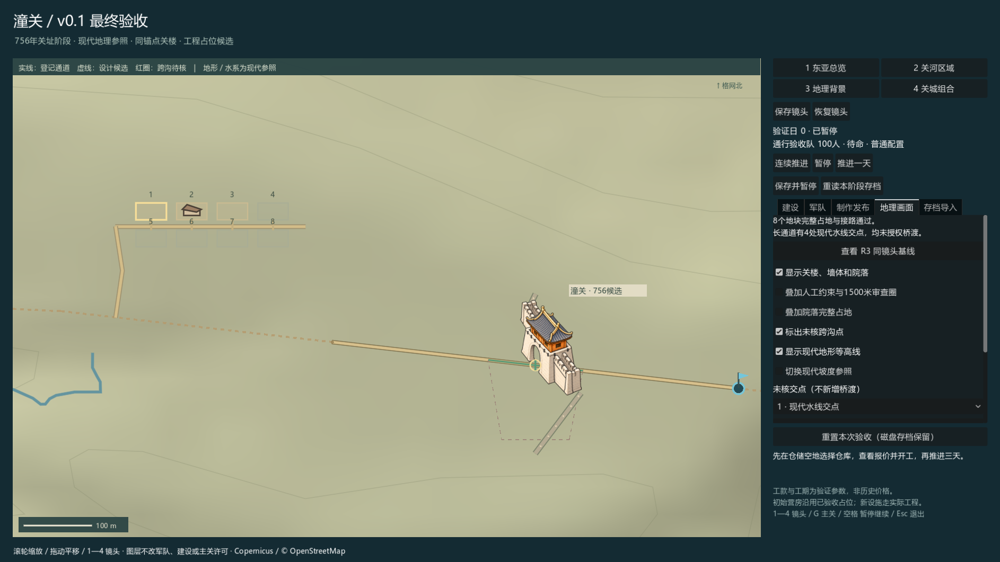

# 地图工坊插件与潼关样板

Godot 4.6.1独立地图工坊，以及潼关v0.1工程原型。包含样板关楼、树图集、地形与水系。

## 下载运行

[下载Windows运行包及插件ZIP](https://github.com/meixin007/-/releases/tag/tongguan-v0.1-r5-candidate-20261015)。

完整解压 tongguan-v0.1-windows-x64-20261015.zip，运行 Start-Final.cmd；制作工具运行 Start-Authoring.cmd。不需要安装Godot、Python或主游戏；两个EXE及同名PCK需保留在Windows目录。

## 源码入口

|内容|入口|说明|
|---|---|---|
|工坊插件|[plugin-source/project.godot](plugin-source/project.godot)|空白工坊，也可安装addons/strategic_map_editor|
|潼关运行端|[runtime/project.godot](samples/tongguan_v01/runtime/project.godot)|四档缩放、拾取、受控移动、主关开闭、建设与存档|
|潼关制作端|[authoring/project.godot](samples/tongguan_v01/authoring/project.godot)|补丁、锁区、重生成、撤销、保存与发布|

使用Godot4.6.1打开对应项目。样板仅将两个export_presets.cfg改为相对输出路径和本机标准模板；其余原生代码/数据/美术保持封存来源。Windows二进制仍为已测 tongguan_v01_final_20261015_03。

[样板操作与限制](samples/tongguan_v01/README.md) · [上传验证](PUBLICATION_VALIDATION.md) · [原设计文档](docs/design/) · [来源说明](THIRD_PARTY_NOTICES.md)

R1—R4已接受，R5技术候选待用户最终验收。756年是战役语境，现代地理参照不是756实测。正式美术、全国生成器、第二节点和主工程部署未自动放行。

本次明确允许上传潼关样板美术及运行包；插件注册表仍为空。未为全工程新增开源许可证，各素材和依赖沿用来源及授权。
