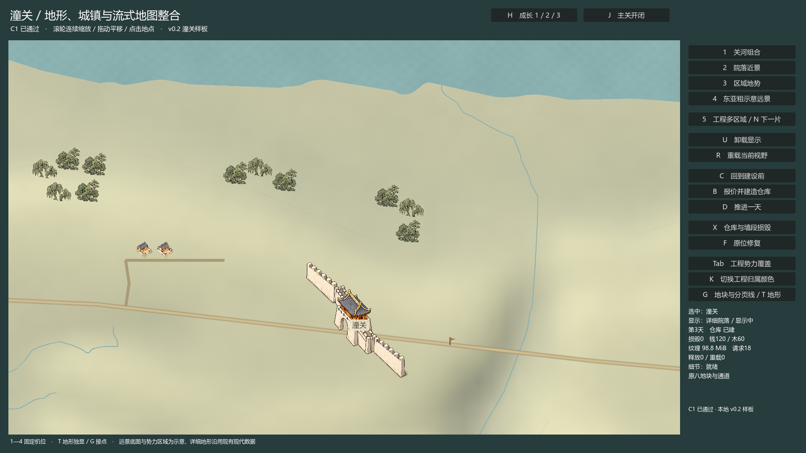

# Q1 完整压力、保护与本地发布验证

构建 `tongguan_v02_q1_20261016_04`，固定合并基线 `62546a547895e1a6185904ad60bf15fa58c03244`。工程、兼容保护和本机性能关卡通过；视觉继承用户已通过的C1，同机位地图逐像素零差。已完成本地版本化Windows发行，完整35项矩阵见下方。构建编号沿用开工时的20261016；封存UTC时间见ACCEPTANCE.json。

## 直接运行

解压 `Release/tongguan_v02_q1_20261016_04_windows.zip` 到新目录，双击 `Start-Q1.cmd`。同目录必须保留 `TongguanQ1.exe` 和 `TongguanQ1.pck`。无需Godot编辑器或工程缓存；最终ZIP实际解压启动通过。SHA256、ZIP CRC与解压产物校验见 [DELIVERY.json](DELIVERY.json)。本机已有独立运行入口：[Start-Q1.cmd](H:/tongguan_reviewfix_20261015/review-work/map_v02/tongguan_v02_q1_20261016_04/CLEAN_WINDOWS/Start-Q1.cmd)。

1—4切换关河组合、院落近景、区域地势和东亚粗示意；滚轮缩放、拖动平移、点击选中。U卸载/R重载，C建设前/B按原合同开工/D推进一天，X损毁/F修复，H成长/J关门，G分页线/T地形独显。5/N切换工程页夹具/下一片；Tab/K工程势力/归属颜色。退出关闭窗口。独立运行数据位于 `user://tests/v02/`，应用配置名 `tongguan_v02_q1_validation`；不迁移旧地图或旧存档。

## 正常视觉的真实帧时

同一台 Ryzen 7 5700X（8核16线程）、RTX4060（8188MiB）、约15.95GiB RAM，NVIDIA616.92；Godot4.6.1 Compatibility正式发行。每轮新进程、10秒预热、同一60秒插值轨迹，300秒重复5次。实际Viewport和物理客户端均1920×1080，DPI/内容缩放、项目设置及原始WDDM实例保留。不限帧、关闭VSync；截图只在采样前后读回。

| 轮次 | 稳态帧数 | p95 ms | p99 ms | 最大ms | >33/50/100ms | Private峰MiB | WDDM专用峰MiB |
|---|---:|---:|---:|---:|---|---:|---:|
| target_60_1 | 39173 | 2.808 | 3.262 | 13.367 | 0/0/0 | 461.59 | 164.74 |
| target_60_2 | 39388 | 2.815 | 3.205 | 13.037 | 0/0/0 | 470.80 | 164.75 |
| target_60_3 | 39034 | 2.819 | 3.265 | 13.658 | 0/0/0 | 455.10 | 164.75 |
| target_300 | 195180 | 2.853 | 3.263 | 14.608 | 0/0/0 | 465.98 | 164.75 |

所有正常轮次均通过p95≤16.7ms、p99≤25ms、Private≤4GiB、实际WDDM专用≤1.5GiB。最差p95=2.853ms、最差p99=3.26467ms、全局最大14.608ms。312775个稳态间隔全部保留，无删尖峰、抽样或最好轮替代。每轮execution/budget、所有预热间隔及长帧镜头字段见[原始汇总](performance/BENCHMARK_SUMMARY.json)和各轮`frames.csv`、`resource_events.jsonl`、`process_samples.jsonl`。

帧时为单调主循环间隔，包含更新/绘制/驱动等待影响；它不是独立GPU执行耗时。显存来自实际PID的Windows WDDM DedicatedUsage，Private来自GetProcessMemoryInfo；Godot纹理计数与加载估算分列。首次正式轨迹、新进程与曾运行过的校验进程分别标记，不宣称清空OS缓存。首个低清可交互、frame_post_draw上界、城市细节与12张所需细页准备时间均保存；无法观测的外部GPU首次展示时间为null。不能把读到日志的时刻当成GPU首帧。

300秒同轨迹16—29秒相位的5个内存窗口，WDDM中位数均170651648字节，Private中位数约432—442MiB，无持续增长；进度对齐约1秒新鲜度，不冒称精确内存事件时点。驱动/分配器池不要求逐字节下降，实际资源释放以固定视野20轮和弱引用为准。[窗口原始计算](performance/SOAK_WINDOWS.json)。

## 旧画风A/B与工程规模

A/B沿用未改的v0.1 `review/canvas.gd`、同素材/状态/轨迹；原六块常驻缓存与全量树计划，对比E2可见查询及E3资源兼容适配。4个固定机位逐像素一致。[像素对照](evidence/AB_PIXEL_COMPARISON.json)。

| 轮次 | 稳态帧数 | p95 ms | p99 ms | 最大ms | >33/50/100ms | Private峰MiB | WDDM专用峰MiB |
|---|---:|---:|---:|---:|---|---:|---:|
| ab_60_old | 212405 | 0.406 | 0.473 | 2.828 | 0/0/0 | 290.45 | 71.66 |
| ab_60_new | 52434 | 1.700 | 2.105 | 2.640 | 0/0/0 | 302.85 | 71.66 |

72棵树的旧内容适配实验中，新链有额外管理成本，p95约1.700ms，相比旧链0.406ms较慢；没有提速声明，也不把它与C1新画风混算。旧CSV中的逻辑resident=0是未埋点占位，实际内存均用OS计数。C1目标负载达标结论来自上面的4次独立正式测量。

E-query的1千、1万、10万对象每档100次查询，结果均为4个可见/提交对象，101次访问桶、404次候选测试、0次查询全扫、1次排序。查询中位数均11μs，索引首次建立分别约27ms、294ms、3037ms；10万元数据仍驻留，未声称全世界元数据常量内存或同时绘制10万物体。[原始query_usec及参考正控制](functional/final_query/engine_result.json)。

E-sites为32个工程代理/4个已有美术详细骨架；E-labels为2000个工程地名、屏幕上限64、选中优先。它们与真实潼关使用同一MapService/加载器，不能作为32座历史城市或全国生产量。所有必测工程profile均execution通过，工程预算和真实目标性能单列。[profile裁定](evidence/ENGINEERING_PROFILES.json)。

## 真实释放与故障

E-stream使用256张不同内容细页，4/8MiB软硬预算，20轮64个不相邻视野。实际访问128张唯一细纹理，35684352字节（34.03125MiB）>软预算3倍。请求2884次，drop/released_observed各2880次，reload2751次；不是隐藏节点。20轮末尾同一视野resident均1115136字节，Resource数量均240，外部残留引用均0。每帧准入账本、所有逐页事件及弱引用窗口完整保留。[流式摘要](evidence/STREAM_SUMMARY.json)。正常4轮和最终发行smoke退出时resident/reserved/inflight/外部引用均0。

真实缺文件、错哈希、延迟A-B-A、半途换包epoch、预算在淡化中缩小、父级未就绪、跨桶大树、共享图集与旧候选分别测试。缺页/哈希错是明确FAILED，父代理只维持覆盖；显式重试成功不篡改原失败。共享图集消费者2→1→0；保留绘制命令的负控制能检出存活纹理，清除节点和绘制引用后才归零。

3个语义阈值与纹理阈值均以6步×双向×20轮、步长至少20ms慢速往返，迟滞范围.98—1.02，无请求风暴或LOD抖动。[真实时间日志/截图](functional/final_fixtures/engine_result.json)；另附[未剪辑原生录像](H:/tongguan_reviewfix_20261015/review-work/map_v02/tongguan_v02_q1_20261016_04/fixture_movie/fixtures.avi)。录像为Godot MovieWriter固定30fps补充记录，与不限帧正式性能分开，不用于性能统计；原文件留在独立工作目录，SHA绑定在报告中，不作为Git源码二进制。

## 保护、局部构建与发布

1939个开工前文件SHA全部不变。19组保护回归涵盖REV-01/02/03、通道、建设、Save22、补丁/删除/锁区、布局与旧原生导入。最终C1原生2157项、Q1故障夹具1458项、查询9项、smoke4项通过；日志无ERROR/WARNING/泄漏诊断。源码与冻结暂存、接受C1收据、EXE/PCK及测量脚本逐项绑定。插件空素材/旧封存/范围/空白检查通过。

原仓库验证器扫描所有文件，首次因保留的旧C1 ZIP报“禁止源码发布载荷”；该失败日志保留。验证器及其判断未修改，另将`git ls-files --cached --others --exclude-standard`的准确源码载荷逐文件复制到隔离目录，运行同一验证器通过。发行ZIP及原始日志按原`.gitignore`规则不属于Git源码载荷。[源码视图结果](evidence/repository_source_view/result.json)。

50轮保护包括数据回归、原版Windows制作发行163项与源码缩放控制162项。最初强制全屏测试误将1440×900逻辑坐标直接裁1728×1080截图，错误区域出现27种哈希；按实际1.2变换映射同一70×65逻辑ROI后，51张受保护区域PNG只有1个哈希，像素相等阈值未放宽。旧制作器代码未改。所有失败、隔离APPDATA路径/原生交换问题及修正证据保留在[evidence/legacy](evidence/legacy/summary.json)。映射依据[Godot4.6官方Viewport文档](https://docs.godotengine.org/en/4.6/classes/class_viewport.html#class-viewport-method-get-stretch-transform)。

局部数值地面64×64m修改只重建root/parent/fine_0_0共3页，17个PNG直接按原哈希复用，1个声明的可选缺页继续缺失；动态对象移动只更新旧/新paint成员关系，不再烘地面。[增量证据](evidence/publication/incremental.json)。Windows实际新目录、校验完整标记、fsync与os.replace切换活动指向；部分解包、坏PCK、ENOSPC写入边界、替换前中断与风格迁移拒绝均保住旧指向。真实旧EXE在切换前与回退后启动，新安装EXE及最终ZIP均干净启动。没有填满真实磁盘，没有改主工程活动指向。[发布验证](evidence/publication/result.json)。

## 全矩阵裁定

| ID | 状态 | 结果 | 证据 |
|---|---|---|---|
| BASE-01 | passed | 19组保护回归，固定合并基线及测量源哈希 | [evidence/legacy/summary.json](evidence/legacy/summary.json) |
| BASE-02 | passed | 1939个开工前文件未变；v4/Save22及旧发行保持 | [evidence/old_file_protection.json](evidence/old_file_protection.json) |
| VIS-01 | accepted_inherited | 用户已通过C1；Q1同机位地图像素零差 | [evidence/C1_APPROVED_MAP_PIXEL_COMPARISON.json](evidence/C1_APPROVED_MAP_PIXEL_COMPARISON.json) |
| VIS-02 | accepted_inherited | 沿用已通过C1的R1连续坡岸，无新美术 | [functional/final_c1/final_composition.png](functional/final_c1/final_composition.png) |
| VIS-03 | accepted_inherited | C1接点/paint/ground画面与几何回归保持 | [functional/final_c1/result.json](functional/final_c1/result.json) |
| VIS-04 | passed | 原位损毁修复、成长与ID/锚点回归；修复地图逐像素一致 | [functional/final_c1/GPU_COMPARISONS.json](functional/final_c1/GPU_COMPARISONS.json) |
| VIS-05 | passed | 迁移拒绝不动活动指向；旧包回退；锁区50轮像素完全相同 | [evidence/publication/result.json](evidence/publication/result.json) |
| GEO-01 | passed | 完整占地、水/路/owner保护及原通道授权回归 | [evidence/legacy/regressions_02/geometry_result.json](evidence/legacy/regressions_02/geometry_result.json) |
| GEO-02 | documented_scope | 原现代DSM/水域来源及R1配方保存；40m数值地形不同于细页纹理密度 | [evidence/accepted_c1_packages.json](evidence/accepted_c1_packages.json) |
| PKG-01 | passed | E1正反例与实际导入纹理像素，路径/哈希/世界兼容拒绝 | [functional/final_fixtures/engine_result.json](functional/final_fixtures/engine_result.json) |
| PKG-02 | passed | 测量包、安装目录及最终ZIP解压目录均为无工程独立EXE | [functional/installed_smoke/result.json](functional/installed_smoke/result.json) |
| PKG-03 | passed | 局部修改闭合3级页；17纹理直接复用；1可选缺页仍声明；动态对象不烘地形 | [evidence/publication/incremental.json](evidence/publication/incremental.json) |
| PKG-04 | passed | 不完整/损坏/ENOSPC/替换前中断均保留旧指向并真实重启 | [evidence/publication/result.json](evidence/publication/result.json) |
| IDX-01 | passed | 参考全集与候选相等；边缘及像素回归保持 | [evidence/legacy/regressions_02/e2_core_result.json](evidence/legacy/regressions_02/e2_core_result.json) |
| IDX-02 | passed | 四桶巨树及非可见owner覆盖，去重提交 | [functional/final_fixtures/engine_result.json](functional/final_fixtures/engine_result.json) |
| IDX-03 | passed | 跨块移动、素材边界修订、局部delta及无旧残影 | [evidence/legacy/regressions_02/e2_core_result.json](evidence/legacy/regressions_02/e2_core_result.json) |
| IDX-04 | passed | 1千/1万/10万离屏目录：每档100查询、404候选测试、0查询全扫、1次排序 | [functional/final_query/engine_result.json](functional/final_query/engine_result.json) |
| LOD-01 | passed | 全尺度往返保留地点ID/选中/逻辑；父级代理持续覆盖 | [functional/final_c1/engine_result.json](functional/final_c1/engine_result.json) |
| LOD-02 | passed | 3语义阈值及纹理阈值各慢速20轮；计数、截图、原生录像 | [functional/final_fixtures/engine_result.json](functional/final_fixtures/engine_result.json) |
| LOD-03 | passed | 7正向GPU对照最大通道差1；40m错位负对照检出 | [functional/final_c1/GPU_COMPARISONS.json](functional/final_c1/GPU_COMPARISONS.json) |
| STR-01 | passed | 所需/预取请求集合与逐页事件；启动未急载旧六块缓存 | [performance/target_60_1/resource_events.jsonl](performance/target_60_1/resource_events.jsonl) |
| STR-02 | passed | 逐帧resident+reserved、decoded和并发准入；另留真实WDDM/PrivateUsage | [functional/final_fixtures/engine_result.json](functional/final_fixtures/engine_result.json) |
| STR-03 | passed | 20轮/128唯一细纹理/34.03MiB>软预算3倍，真实drop/reload/弱引用窗口 | [evidence/STREAM_SUMMARY.json](evidence/STREAM_SUMMARY.json) |
| STR-04 | passed | A-B-A与切包epoch，延迟旧任务只排空不挂接 | [functional/final_fixtures/engine_result.json](functional/final_fixtures/engine_result.json) |
| STR-05 | passed | 真实缺文件、错哈希明确FAILED与父回退/显式重试；延迟与父未就绪可恢复 | [functional/final_fixtures/engine_result.json](functional/final_fixtures/engine_result.json) |
| STR-06 | passed | 共享图集2→1→0消费者，最后引用释放；隐藏负对照检出持有 | [functional/final_fixtures/engine_result.json](functional/final_fixtures/engine_result.json) |
| STATE-01 | passed | 卸载不改日期；原时钟建设完成，重载读当前损毁与修复权威 | [functional/final_c1/engine_result.json](functional/final_c1/engine_result.json) |
| STATE-02 | passed | 32项旧存档回归及新表现兼容/不兼容明确拒绝 | [evidence/legacy/regressions_02/saves_result.json](evidence/legacy/regressions_02/saves_result.json) |
| EDIT-01 | passed | 50轮数据保护+原版发行50轮像素+源码缩放正确ROI50轮像素 | [evidence/legacy/summary.json](evidence/legacy/summary.json) |
| EDIT-02 | passed | REV-01/02/03、旧冲突收据及新增占地不能复用旧豁免 | [evidence/legacy/regressions_02/geometry_result.json](evidence/legacy/regressions_02/geometry_result.json) |
| FAR-01 | passed | 2000标签选中优先/64屏幕限额；避让与势力变化不重烘地形 | [functional/final_fixtures/engine_result.json](functional/final_fixtures/engine_result.json) |
| PERF-01 | passed | 3×60秒真实1080p全部达标；原始数据无裁剪 | [performance/BENCHMARK_SUMMARY.json](performance/BENCHMARK_SUMMARY.json) |
| PERF-02 | passed | 300秒达标；0个>33ms帧；同轨迹内存窗口与退出全释放 | [performance/SOAK_WINDOWS.json](performance/SOAK_WINDOWS.json) |
| PERF-03 | passed_scoped | 全部必测工程档execution通过；预算仅按各自冻结profile裁定 | [evidence/ENGINEERING_PROFILES.json](evidence/ENGINEERING_PROFILES.json) |
| REL-01 | passed | 最终ZIP校验/干净解压启动、实际Windows切换及原旧EXE回退启动 | [DELIVERY.json](DELIVERY.json) |

## 本次边界与已知限制

视觉为用户通过C1后的继承，不新增一轮作者签名；Q1地图ROI与C1完全相同。历史来源记录通过，精确756年历史复原未签署；现代DSM/岸线、东亚粗示意仍保持原标识。只有本机/当前分辨率的性能结论，未宣称第二台设备、全国资源容量或深mip已验证。旧内容兼容适配的额外成本如上真实报告。

没有覆盖旧地图、素材、旧收据与旧发行，没有生成新AI美术或量产，没有提交/推送/外部发布。v0.3第二真实节点需另行确定，本次停在Q1。回退只需关闭Q1并运行原独立旧发行；不需要回滚任何旧地图文件。

最终源码载荷复核：两份重复嵌入完整引擎事件的`result.json`超过95MiB，原始字节已无损封存于[evidence/raw_duplicate_results.zip](evidence/raw_duplicate_results.zip)，逐成员SHA/CRC见[RAW_EVIDENCE.json](evidence/RAW_EVIDENCE.json)。可读回执保留execution、budget和内存等字段，独立`engine_result.json`及全部CSV/JSONL未改动。最终ZIP仍保留原始完整回执；发行EXE/PCK与正式测量一致。
