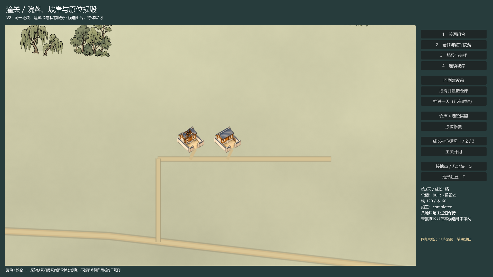
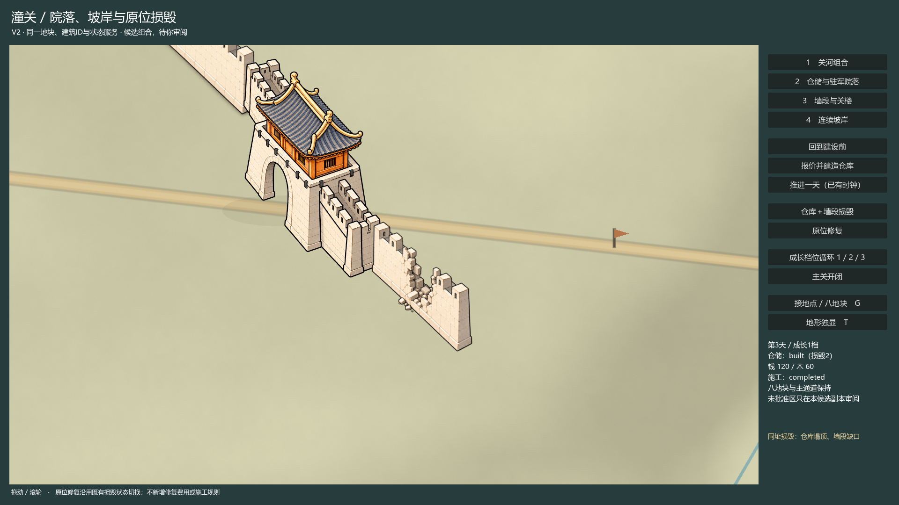

# V2 Godot组合审阅候选

构建 `tongguan_v02_v2_20261016_02`，视觉状态 **pending**。新增坡岸/院落/墙段与已有建设、成长、损毁、修复的组合入口；原地图、素材、八地块、ID及封存交付不覆盖。技术验证通过不代签美术审阅。

启动 [Start-V2.cmd](H:/tongguan_reviewfix_20261015/review-work/map_v02/tongguan_v02_v2_20261016_02/CLEAN_WINDOWS/Start-V2.cmd)。可编辑Godot工程为同目录SOURCE_RUNTIME/project.godot，组合场景SOURCE_RUNTIME/v02/v2/composition.tscn。按1—4切关河、院落、墙楼、坡岸；G看地块/接点，T地形独显，B切13组已接受V1小样林簇。拖动/滚轮平移缩放。

初始已通过原服务完成仓库示例：实付120钱/20木、3天。可按“回到建设前”→“报价并建造仓库”→推进3天；点“仓库＋墙段损毁”查看实际塌顶与缺口，再点“原位修复”。修复沿用已有set_damage状态接口，不增加维修价格、工期或战斗。可切原成长档位与主关控制。所有运行进度仅在新user://tests/v02/v2/<unique-run>检查点。

## 同机位证据

另有组合、坡岸、地形独显、建设前/中/后、三档成长与12帧连续相机序列，保存在native/，均为实际1920×1080 Godot读回，无后期修图。地图区修复前后逐像素相同，ID、位置、比例、接地点、合同和已付资源不变。

## 资产与迁移

仅用内置image_gen补3张必要PNG，未批量扩充。素材及SHA见[assets.json](assets.json)，完整执行规格/提示集见[generation_prompts.json](generation_prompts.json)：

- [仓库塌顶](H:/tongguan_reviewfix_20261015/samples/tongguan_v01/runtime/v02/v2/assets/warehouse_damaged_v01.png)
- [墙段缺口](H:/tongguan_reviewfix_20261015/samples/tongguan_v01/runtime/v02/v2/assets/wall_damaged_v01.png)
- [驻军院落](H:/tongguan_reviewfix_20261015/samples/tongguan_v01/runtime/v02/v2/assets/barracks_v01.png)

三图均1536×1024透明画布，固定方向/原锚点/同一光向；仓库与墙完整态继续直接用原V1文件。损毁1/2共用一张受损图，驻军损毁变体不在本有限小样内；其它建筑门类不扩图。生成图保持原注册坐标，但其形制与像素对齐仍由作者审阅，不能以程序变换一致代替视觉判断。

V1的坡岸、水、道路、关楼、墙和13组已接受小样林簇继续用于本候选。原72实例仍按原发布ID/位置读取；13组小样林簇另标v1.preview.*，只在新审阅副本显示，不是新增正式地图数据。新风格迁移范围见[visual_migration.json](visual_migration.json)，保持pending；拒绝时直接回旧包，旧锁区像素不变。

## 技术与保护

- 当前源码契约23项、原生103项通过；退出0，无超时、ERROR/WARNING/资源泄漏诊断。原生包括实际纹理切换、建设/资金/木料、同机位像素恢复、稳定身份/变换、Save22恢复、相机只读、成长/关门独立性及原72实例/13小样分离。
- 原建设、owner、发布、通道及存档回归均通过；存档明确使用原TONGGUAN_R5_FIXTURES夹具。仓库范围、插件空素材注册表、旧封存与空白检查通过。
- 开工前1632个已有文件SHA全部不变。原主工程/历史开发目录未写；旧地图/PNG/注册表/保存格式/通道几何未改，未提交、推送或发布。
- 唯一GameState/Context由原FinalController创建；新Session不初始化旧视觉缓存。V2场景表现与E3正式合流留给C1；不宣称E3离屏玩法已在本入口整合，也不宣称Q1性能或历史通过。

作者意见仍为空：[visual_review.json](visual_review.json)。本批停止在可操作候选审阅，未签署视觉接受、未启动下一批。构建01原生102项通过；02保留已接受V1林簇并增加来源分离检查，为本次交付。
